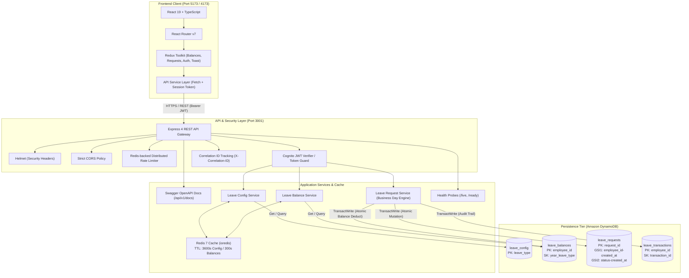

# LeaveFlow — Enterprise Employee Leave Management System

A production-ready, full-stack Employee Leave Management Portal architected for high availability, transactional consistency, and enterprise resilience.

LeaveFlow connects a high-performance **React 19 + TypeScript + Redux Toolkit** single-page application to an enterprise-grade **Node.js + Express + TypeScript** REST API backed by **Amazon DynamoDB** and **Redis**.

---

## 1. System Architecture



---

## 2. Monorepo Project Structure

```
member4-dashboard/
├── frontend/                # React 19 + TypeScript + Redux Toolkit SPA
│   ├── src/                 # Application code (pages, components, slices, services)
│   ├── public/              # Static public assets
│   ├── package.json         # Frontend dependencies & scripts
│   ├── vite.config.ts       # Vite bundler configuration
│   ├── tsconfig.json        # TypeScript configuration
│   └── .env                 # Environment variables (VITE_API_BASE_URL)
├── backend/                 # Node.js + Express + TypeScript REST API
│   ├── src/                 # REST controllers, domain services, DynamoDB/Redis configs
│   ├── scripts/             # DynamoDB table initialization and data seeding scripts
│   ├── tests/               # Vitest integration test suite (18 tests)
│   ├── package.json         # Backend dependencies & scripts
│   ├── tsconfig.json        # TypeScript backend compiler configuration
│   └── .env                 # Environment variables (DynamoDB, Redis, Cognito)
├── package.json             # Root monorepo workspace runner
└── README.md
```

---

## 3. Technology Stack

### Frontend
- **Framework:** React 19 (`react`, `react-dom`)
- **Language:** TypeScript 5.7 (strict type safety)
- **State Management:** Redux Toolkit (`@reduxjs/toolkit`, `react-redux`)
- **Routing:** React Router v7 (`react-router-dom`)
- **Build Tool:** Vite 8.3 with `@vitejs/plugin-react`
- **Linting:** Oxlint (high-performance linter, 0 warnings)
- **Styling:** Custom Enterprise LeaveFlow Design System (CSS variables, responsive layouts, accessible contrast)
- **Icons:** Lucide React

### Backend
- **Runtime:** Node.js (v20+) + Express 4.21
- **Language:** TypeScript 5.7 with native ES modules (`"type": "module"`)
- **Database:** Amazon DynamoDB (AWS SDK v3 `@aws-sdk/client-dynamodb` & `@aws-sdk/lib-dynamodb`)
- **Cache:** Redis 7 via `ioredis` with non-blocking fallback
- **Authentication:** AWS Cognito JWT verification via `aws-jwt-verify`
- **Security:** `helmet`, `cors`, `express-rate-limit`, `rate-limit-redis`
- **Validation:** Zod 3.24
- **API Documentation:** OpenAPI 3.0 / Swagger UI (`swagger-ui-express`, `yamljs`)
- **Testing:** Vitest 3.0 + Supertest 7.0

---

## 3. DynamoDB Data Schema

The database design strictly enforces the confirmed DynamoDB key structures and access patterns:

| Table Name | Partition Key | Sort Key | Purpose / Description |
|---|---|---|---|
| `leave_config` | `leave_type` (S) | *None* | Entitlement rules, notice periods, and maximum consecutive limits per leave type (`ANNUAL`, `SICK`, `CASUAL`, `UNPAID`). |
| `leave_balances` | `employee_id` (S) | `year_leave_type` (S) | Allocated, used, pending, and available days (e.g. `2026#ANNUAL`). |
| `leave_requests` | `request_id` (S) | *None* | Individual leave applications with status, date ranges, and approval workflows. |
| `leave_transactions` | `employee_id` (S) | `transaction_id` (S) | Immutable audit trail tracking balance additions, deductions, and cancellations. |

### Global Secondary Indexes (on `leave_requests`)
1. **`employee_id-created_at-index`**: Enables fast, indexed sorting of an employee's application history.
   - Partition Key: `employee_id` (S)
   - Sort Key: `created_at` (S)
2. **`status-created_at-index`**: Enables manager and HR queues by status.
   - Partition Key: `status` (S)
   - Sort Key: `created_at` (S)

### ACID Transaction Guarantees
All leave request submissions and cancellations execute via DynamoDB `TransactWriteCommand`:
- **Submission:** Atomically inserts into `leave_requests`, deducts balance from `leave_balances` with condition expression `available >= :days`, and creates an immutable audit record in `leave_transactions`.
- **Cancellation:** Atomically marks `leave_requests` as `CANCELLED`, restores `available` and decreases `pending` in `leave_balances`, and records a reversal audit record in `leave_transactions`.

---

## 4. Redis Caching & Rate Limiting Strategy

1. **Read-Through Caching:**
   - Leave policy rules (`leave_config`) are cached for 1 hour (`TTL = 3600s`).
   - Employee balances (`leave_balances`) are cached for 5 minutes (`TTL = 300s`).
2. **Atomic Invalidation:**
   - Any leave request creation or cancellation immediately evicts the employee's cached balances (`leaveflow:balances:{employeeId}:*`).
3. **Resilient Degraded Mode:**
   - If Redis connection drops or fails, the application logs a warning and falls back to direct DynamoDB reads without breaking user operations.
4. **Distributed Rate Limiting:**
   - General API limiter: 120 requests / minute / IP.
   - Leave submission limiter: 10 requests / minute / IP.

---

## 5. API Endpoints & Swagger Documentation

Interactive OpenAPI / Swagger UI documentation is available at:
```
http://localhost:3001/api/v1/docs
```

### Core Routes:

| Method | Endpoint | Description | Auth Required |
|---|---|---|---|
| `GET` | `/api/v1/health/live` | Process liveness probe | No |
| `GET` | `/api/v1/health/ready` | Readiness probe (DynamoDB & Redis health) | No |
| `GET` | `/api/v1/docs` | Interactive Swagger API documentation | No |
| `GET` | `/api/v1/employee/me` | Authenticated employee profile | Yes (Bearer JWT) |
| `GET` | `/api/v1/leave/config` | Active leave types and rules | Yes (Bearer JWT) |
| `GET` | `/api/v1/leave/balances` | Employee leave balances for specified year | Yes (Bearer JWT) |
| `GET` | `/api/v1/leave/requests` | List leave requests (supports status/type filters) | Yes (Bearer JWT) |
| `POST` | `/api/v1/leave/requests` | Submit new leave application | Yes (Bearer JWT) |
| `GET` | `/api/v1/leave/requests/:id` | Fetch leave request by ID | Yes (Bearer JWT) |
| `POST` | `/api/v1/leave/requests/:id/cancel` | Cancel pending request & restore balances | Yes (Bearer JWT) |

---

## 6. Quickstart Guide

### Prerequisites
- Node.js 20+ and npm 10+
- Docker (for local DynamoDB and Redis)

### Step 1: Start Redis and DynamoDB Local
```bash
# Start Redis (port 6379)
docker run -d --name leaveflow-redis -p 6379:6379 redis:7-alpine

# Start DynamoDB Local (port 8000)
docker run -d --name leaveflow-dynamodb -p 8000:8000 amazon/dynamodb-local -jar DynamoDBLocal.jar -sharedDb
```

### Step 2: Initialize Database and Seed Data
```bash
cd backend
npm install
npm run init:db   # Creates leave_config, leave_balances, leave_requests, leave_transactions
npm run seed      # Seeds leave rules and initial balances for EMP001
```

### Step 3: Run Development Servers

You can run both services independently or from the root monorepo scripts:

```bash
# Option A: From root using workspace scripts
npm run dev:backend    # Starts Express backend on http://localhost:3001
npm run dev:frontend   # Starts Vite frontend on http://localhost:5173

# Option B: From respective folders
cd backend && npm run dev
cd frontend && npm run dev
```

Navigate to `http://localhost:5173` to access the LeaveFlow portal.

---

## 7. Testing & Quality Verification

### Run Backend Unit & Integration Tests
```bash
npm run test:backend   # Or cd backend && npm test (18 passed tests)
```

### Run Linters & TypeScript Checks
```bash
npm run lint           # Lints both backend and frontend (0 errors, 0 warnings)
npm run build          # Builds both backend and frontend distributions
```

---

## 8. Security & Compliance
- **Zero Synthetic Fallbacks:** When backend services are unavailable, the frontend displays an honest unavailable error rather than fabricated balances.
- **Traceability:** Every incoming request is stamped with a unique `X-Correlation-ID` for end-to-end distributed tracing.
- **Cognito Integration:** Native verification using `aws-jwt-verify` against AWS Cognito User Pools with production secret protections.
